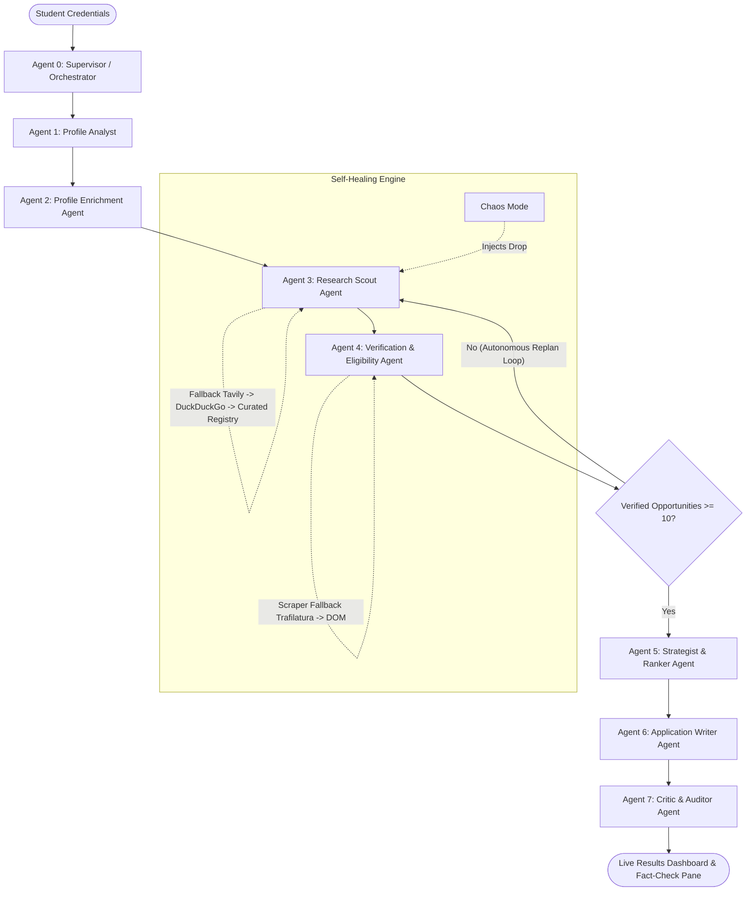

# 🎓 ScholarSwarm: Autonomous Multi-Agent Scholarship Research System

> **"Your scholarship research team. 7 AI agents. One click."**  
> An autonomous multi-agent AI system that parses student credentials, performs live internet research across official university and government portals, verifies criteria with zero fabrication, ranks top opportunities, drafts grounded SOPs with fact-checking citations, and recovers from network failures with an integrated Chaos Mode.

---

## 🌟 Key Capabilities

- **7 Autonomous Collaborating Agents**: Coordinated by a Supervisor with health monitoring and dynamic replanning loops (re-scouts if < 10 verified opportunities survive).
- **100% Real Live Opportunities**: Crawls official educational and governmental portals (`.edu`, `.gov`, `.gc.ca`, `.daad.de`, `.a-star.edu.sg`, `.europa.eu`).
- **Strict Evidence Citation & Anti-Hallucination**: Evaluates 5-point eligibility criteria (GPA, degree, field, nationality, language) with exact verbatim snippets from source pages.
- **Fact-Checked Statement of Purpose**: Generates tailored SOP drafts and professor recommendation request emails where every factual claim links back to student evidence.
- **Interactive Mission Control**: Glowing topological agent network graph, real-time Server-Sent Events (SSE) terminal, and progress rail.
- **Chaos Mode & Self-Healing Showpiece**: Simulates 45% network failure rates (search drops, HTTP timeouts); agents autonomously recover using fallback search cascades and DOM parsers.
- **Zero-Code Surprise Profile Adaptability**: Seamlessly handles any discipline (Computer Science, Commerce/Finance, Biotechnology) or destination country without code modifications.

---

## 🏗️ Multi-Agent Architecture



---

## 🚀 Quick Start (Under 5 Minutes)

### Option A: One-Command Docker Compose (Recommended)
```bash
# Clone and run
docker compose up --build
```
- Frontend: `http://localhost:3000`
- Backend API & Docs: `http://localhost:8000/docs`

---

### Option B: Local Dual-Terminal Run

#### 1. Backend (FastAPI + Python 3.11+)
```bash
cd backend
pip install -r requirements.txt
uvicorn app.main:app --reload --port 8000
```

#### 2. Frontend (React + Vite + TypeScript + Tailwind)
```bash
cd frontend
npm install
npm run dev
```
- Open `http://localhost:5173` in your browser.

---

## 🔑 Environment Configuration (`.env`)

All API keys are optional with graceful fallbacks. If no keys are provided, ScholarSwarm operates seamlessly using DuckDuckGo search, GitHub public REST API, and offline heuristics.

```ini
# Google Gemini API Key (gemini-2.0-flash / gemini-1.5-flash)
GEMINI_API_KEY=

# Tavily AI Search (Optional, falls back to DuckDuckGo)
TAVILY_API_KEY=

# GitHub Token (Optional, raises rate limit to 5,000 req/hr)
GITHUB_TOKEN=

# System Tuning
MIN_VERIFIED_OPPORTUNITIES=10
CANDIDATES_HARVEST_TARGET=15
ENABLE_CACHE=true
```

---

## 🧪 Running Automated Unit & E2E Tests

```bash
# Run full pytest test suite
python -m pytest backend/tests -v
```
All 7 unit and end-to-end swarm integration tests validate:
- GPA normalization across 10-scale, 4-scale, and percentage grades.
- Autonomous multi-tier search fallback and cache persistence.
- Official page verification and 5-point eligibility evaluation.
- Chaos engine fault injection and self-healing recovery.
- End-to-end 7-agent execution with SOP drafting and Trust Report generation.

---

## 🎭 Live Demo & Surprise Profile Swapping

1. Click **"Try Demo Profile (Rahul - CSE 8.2 CGPA)"** on the landing page to load the default hackathon candidate.
2. Toggle **Chaos Mode** to watch agents self-heal when search calls or page scrapes drop.
3. Click **"Deploy ScholarSwarm"** to view real-time data flows on the topological agent graph.
4. Review the **Top 5 Strategic Matches** and the **Fact-Check Verification Pane** in the SOP Studio.
5. Click **"New Profile (Surprise Demo)"** to swap in **Ananya Sen (Commerce / Finance)** or **Priya Nair (Biotech Germany)** with zero code changes!

---

## 📁 Repository Structure

```
scholarswarm/
├── backend/
│   ├── app/
│   │   ├── main.py                     # FastAPI REST API & SSE streaming
│   │   ├── config.py                   # Pydantic Settings
│   │   ├── chaos.py                    # Chaos mode failure injector
│   │   ├── models/                     # Profile, Opportunity, Ranking, Application, Events
│   │   ├── services/                   # LLM, Search, Scraper, GitHub, DocParser, Cache
│   │   ├── agents/                     # 7 specialized agents + Supervisor
│   │   └── registry/sources.yaml       # Curated registry of official portals
│   ├── tests/                          # Pytest suite
│   ├── requirements.txt
│   └── Dockerfile
├── frontend/
│   ├── src/
│   │   ├── components/                 # Hero, Intake, MissionControl, Results, Studio, Modals
│   │   ├── hooks/useSwarmSSE.ts        # Resilient EventSource SSE hook
│   │   ├── types/swarm.ts              # TypeScript schemas
│   │   └── styles/index.css            # Aurora tokens & glassmorphism
│   ├── package.json, vite.config.ts, tailwind.config.js
│   └── Dockerfile
├── samples/                            # Rahul sample CV/transcript, Commerce, Biotech profiles
├── docs/                               # ARCHITECTURE.md, NOTE.md, DEMO_SCRIPT.md
├── docker-compose.yml
├── Makefile
└── .env.example
```

---

## ⚖️ Non-Negotiable Quality & Ethical Rules
- **No Inventions**: Every program name, amount, deadline, and eligibility status is grounded in verified sources.
- **Non-Submitting**: Generates research drafts and templates only; no actual submission features.
- **Privacy First**: Uses fictional and consented student test data only.
