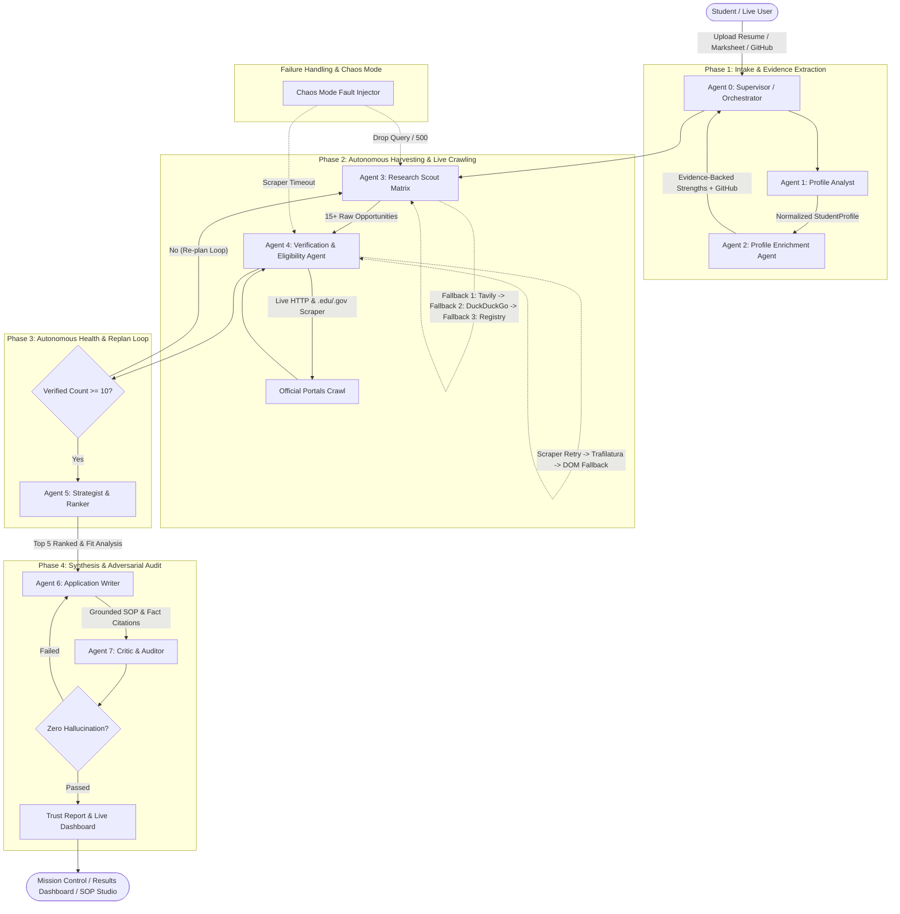

# ScholarSwarm Architecture & Agent Topology

ScholarSwarm is a hierarchical, collaborative multi-agent AI system designed to conduct rigorous, verified scholarship research and application drafting.

---

## 1. System Architecture Diagram

---

## 2. Multi-Agent Team Breakdown

| Agent | Responsibility | Key Input | Key Output |
| :--- | :--- | :--- | :--- |
| **0. Supervisor** | Lifecycle planning, health monitoring, dynamic replanning loops. | `SwarmState` | Routes tasks, replans if verified < 10. |
| **1. Profile Analyst** | Parses PDF/DOCX/Text, normalizes GPA to 10-scale and 4-scale. | Resume & transcript bytes | `StudentProfile` with explicit unknowns. |
| **2. Profile Enrichment** | Calls GitHub REST API (stars, repos, READMEs), extracts evidence. | GitHub username, links | `EvidenceStrength` with verifiable citations. |
| **3. Research Scout** | Generates Country × Degree × Field query matrix, parallel searches. | Profile preferences | 15+ candidate opportunities. |
| **4. Verification Agent** | Crawls official pages (`.edu`, `.gov`, `.ac.`), extracts eligibility criteria. | Candidate URLs | 5-point criteria evaluation (MET/NOT MET). |
| **5. Strategist Ranker** | Scores fit, funding generosity, competitiveness ("Reach/Target/Safe"). | Verified opportunities | Top 5 picks, missing items, application roadmaps. |
| **6. Application Writer** | Drafts Statement of Purpose grounded strictly in verified profile facts. | Top opportunity + Profile | SOP draft, fact-check claims, LOR email template. |
| **7. Critic & Auditor** | Adversarial audit for hallucination, link rot, and criteria conflicts. | Final recommendations | `TrustReport` with confidence gauge & source audit. |

---

## 3. Self-Healing & Fault-Tolerance Pathways

1. **Search Tier Cascade**:
   - Primary: Tavily AI Search (if key provided).
   - Secondary: DuckDuckGo automated fallback (zero key required).
   - Tertiary: Curated official source registry (`sources.yaml`).
2. **Scraper Resiliency**:
   - Handles bot challenges using realistic Chromium browser headers.
   - Dual-engine parsing: Trafilatura clean extraction + BeautifulSoup DOM fallback.
3. **LLM Abstraction & Heuristic Recovery**:
   - Primary: Google Gemini 2.0 Flash / 1.5 Flash.
   - Secondary: OpenAI or Groq API.
   - Offline Heuristic Engine: Ensures system continues smoothly during Wi-Fi outages or rate-limit blocks.
4. **Chaos Mode**:
   - Randomly injects 45% fault rate into search calls and web scraping.
   - System automatically recovers, recording each self-healing event with toast notifications.
