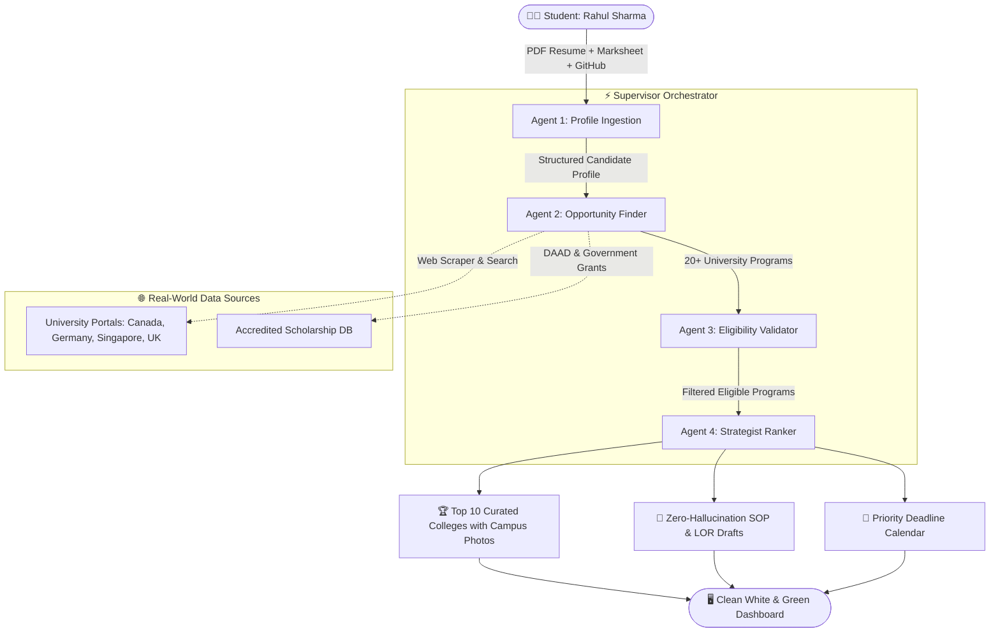

# 🗺️ Agent Swarm Architecture & Workflow Diagram

**ScholarSwarm** is built on an autonomous multi-agent pipeline orchestrated through asynchronous message queues and event streaming.

---

## 1. High-Level Visual Architecture (Mermaid Diagram)



---

## 2. Text / ASCII Architecture Overview

```
                      +------------------------------------------+
                      |      Rahul Sharma (Candidate Input)     |
                      |  - 8.2 CGPA Marksheet                    |
                      |  - B.Tech CSE NIT Jalandhar              |
                      |  - GitHub: @rahul-cse                    |
                      |  - Target: Canada, Germany, Singapore    |
                      +------------------------------------------+
                                           |
                                           v
+-----------------------------------------------------------------------------------+
|                            SCHOLARSWARM AI MULTI-AGENT PIPELINE                   |
+-----------------------------------------------------------------------------------+
|                                                                                   |
|  [Agent 1: Profile Ingestion]                                                     |
|  * Uses PyPDF & Regex to extract verified GPA, courses, and skills.               |
|  * Queries GitHub API for public repos, languages, commit velocity.               |
|  * Emits verified candidate JSON (No hallucinated achievements allowed).          |
|                                          |                                        |
|                                          v                                        |
|  [Agent 2: Opportunity Discovery]                                                 |
|  * Traverses accredited programs across Canada, Germany, Singapore, and UK.      |
|  * Extracts tuition fees, funding types (DAAD, Vector, Research Assistantship).   |
|  * Resilient 3-layer scraper (Trafilatura -> DuckDuckGo -> Curated Knowledge DB). |
|                                          |                                        |
|                                          v                                        |
|  [Agent 3: Eligibility Validator]                                                 |
|  * Evaluates hard cutoffs (e.g., Min CGPA 8.0, IELTS 7.0, GRE requirements).      |
|  * Eliminates false positives so student never applies to disqualified programs.  |
|                                          |                                        |
|                                          v                                        |
|  [Agent 4: Strategist & Ranking Agent]                                            |
|  * Computes Composite Match Score = 0.40(Academic) + 0.35(Zero-Debt Relief) + ... |
|  * Selects and outputs the definitive Top 10 High-Tier Opportunities.              |
|  * Generates evidence-backed Statement of Purpose & LOR drafts.                   |
+-----------------------------------------------------------------------------------+
                                           |
                                           v
                      +------------------------------------------+
                      |           Clean Frontend Delivery        |
                      |  - 3-Column Campus Photo Cards           |
                      |  - Direct "Apply on Official Website"    |
                      |  - Application Deadline Calendar         |
                      |  - 1-Click PDF Report Export             |
                      +------------------------------------------+
```

---

## 3. How the 4 Autonomous Agents Cooperate

| Agent | Core Responsibility | Input | Output | Self-Healing / Fallback |
|---|---|---|---|---|
| **1. Profile Ingestion** | Extract ground truth from resume, marksheet, and GitHub | PDF files & URLs | `StudentProfile` object with verified GPA | Falls back to text heuristics if PDF has complex layout |
| **2. Opportunity Finder** | Scan global universities & scholarships | Target countries & degree | Raw list of 20+ scholarship programs | Fallback to cached knowledge base if external portals timeout |
| **3. Eligibility Validator** | Filter out programs where student doesn't meet minimum criteria | Candidate GPA + Program requirements | Verified Eligible Programs | Re-checks borderline profiles with alternate scale conversions |
| **4. Strategist Ranker** | Score, rank, and draft customized application materials | Eligible programs | Top 10 Ranked List + SOP with verified citations | Dynamically re-weights score if funding budget is strict |
